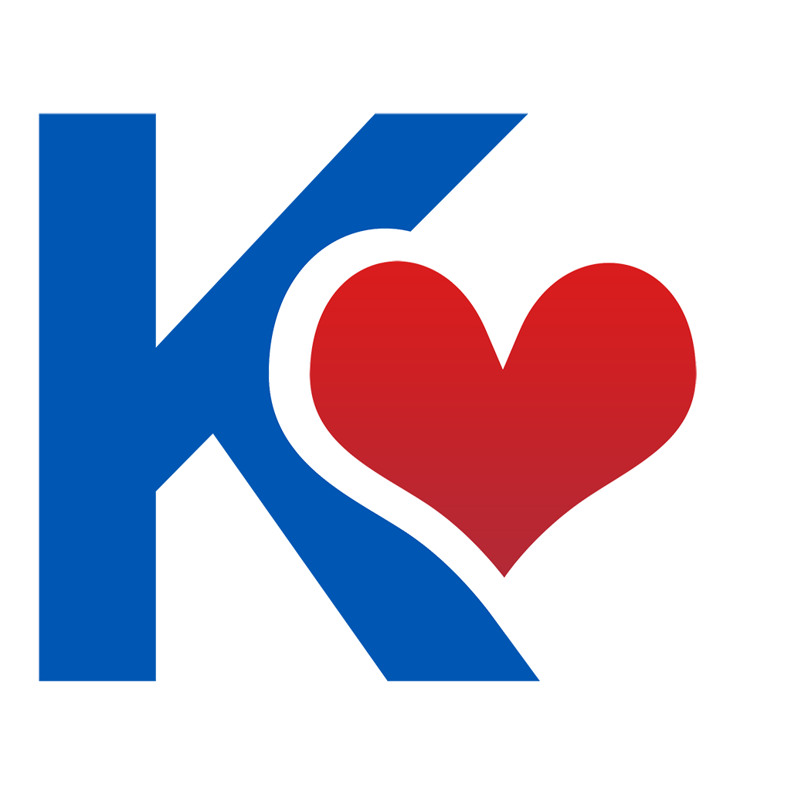

# 💙 Kindred

<div align="center">



**Aplicativo móvel para armazenamento e gestão de informações de saúde integrado a sensores inteligentes para acompanhamento idoso-familiar.**

[](https://choosealicense.com/licenses/mit/)
[](https://github.com/seu-usuario/kindred/stargazers)
[](https://github.com/seu-usuario/kindred/network/members)
[](http://makeapullrequest.com)

[Protótipo no Figma] (https://www.figma.com/make/xIHT6C9rhGmWIqazJeKnKM/Kindred-Health-Tracking-App?t=DWf4TNNeJsI6Z7KL-20&fullscreen=1) · [Reportar Bug](https://github.com/seu-usuario/kindred/issues) · [Solicitar Feature](https://github.com/seu-usuario/kindred/issues)

</div>

---

## 📋 Sobre o Projeto

A gestão da rotina de saúde representa um desafio diário para muitas pessoas idosas e seus familiares. Informações essenciais — como medições de glicemia, pressão arterial, horários de medicamentos e hidratação — costumam ficar dispersas em anotações de papel, mensagens soltas ou na memória dos cuidadores.

O **Kindred** resolve esse problema oferecendo um diário digital centralizado, acessível e colaborativo. A plataforma permite que o idoso ou seus responsáveis autorizados registrem métricas de saúde, configurem lembretes de rotina e acompanhem a evolução clínica de forma visual, além de contar com um sistema preventivo de detecção de movimentos bruscos via sensores do smartphone.

> **Nota Regulatória:** O Kindred atua exclusivamente como ferramenta auxiliar de registro e organização, sem finalidade diagnóstica ou terapêutica, em conformidade com a **RDC ANVISA nº 657/2022** e a **LGPD**.

### ✨ Principais Funcionalidades

- 🎯 **Diário Digital Biométrico & Voz (RF02)** - Registro simplificado de glicemia, pressão arterial, oxigenação ($\text{SpO}_2$), medicação e temperatura corporal, com suporte a comandos de voz (*Speech-to-Text*).
- ⚡ **Cuidado Compartilhado via QR Code (RF03)** - Vinculação rápida de múltiplos familiares e cuidadores à conta do idoso, com níveis de permissão configuráveis e sincronização em tempo real.
- 🔒 **Monitoramento Inteligente de Segurança (RF06)** - Processamento contínuo em segundo plano do acelerômetro e giroscópio para detectar impactos atípicos, disparando o alerta *"Está tudo bem?"* com contagem regressiva e notificação automática à rede de apoio.
- 🎨 **Acessibilidade Adaptativa (RNF01)** - Interface inclusiva baseada nas diretrizes **WCAG 2.2** e **e-MAG**, com botões ampliados ($\ge 48\times48\text{ px}$), tipografia escalável, alto contraste e leitura por síntese de voz (*Text-to-Speech*).
- ⏰ **Lembretes e Relatórios em PDF (RF04 / RF05)** - Alarmes programáveis para medicamentos e hidratação com confirmação de status, gráficos interativos e exportação do histórico consolidado em PDF para consultas médicas.

---

## 🎬 Demonstração

### Screenshots

<div align="center">
  
  
</div>

### GIF Demonstrativo

<div align="center">
  
</div>

---

## 🛠️ Tecnologias Utilizadas

### Mobile / Frontend
- 
- 
- 
- 

### Backend & Armazenamento (*Offline-First*)
- 
- 

### Ferramentas
- 
- 
- 

---

## 🚀 Começando

### 📦 Pré-requisitos

Antes de começar, certifique-se de ter instalado:

- [Node.js](https://nodejs.org/) (versão 18 ou superior)
- [npm](https://www.npmjs.com/) ou [yarn](https://yarnpkg.com/)
- [Git](https://git-scm.com/)
- Aplicativo **Expo Go** instalado no seu smartphone (Android/iOS)

### 💻 Instalação

1. **Clone o repositório**
   ```bash
   git clone [https://github.com/seu-usuario/kindred.git](https://github.com/seu-usuario/kindred.git)
